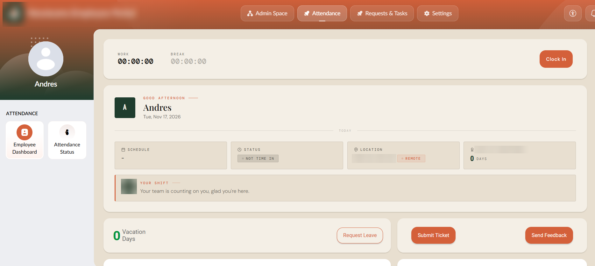
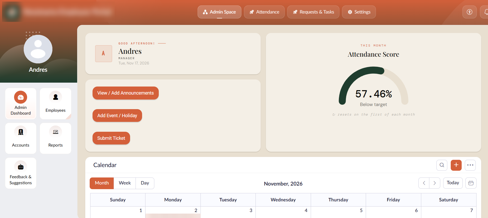
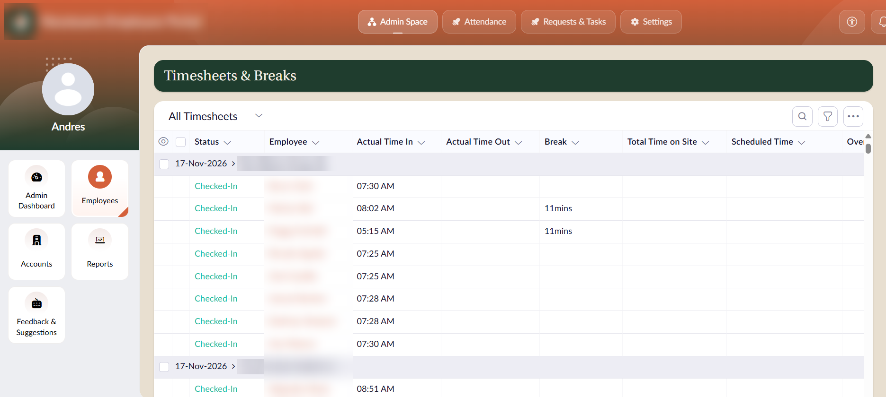
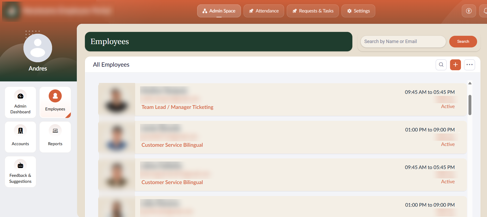
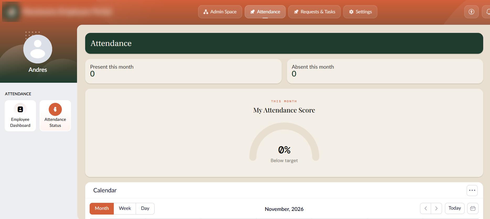
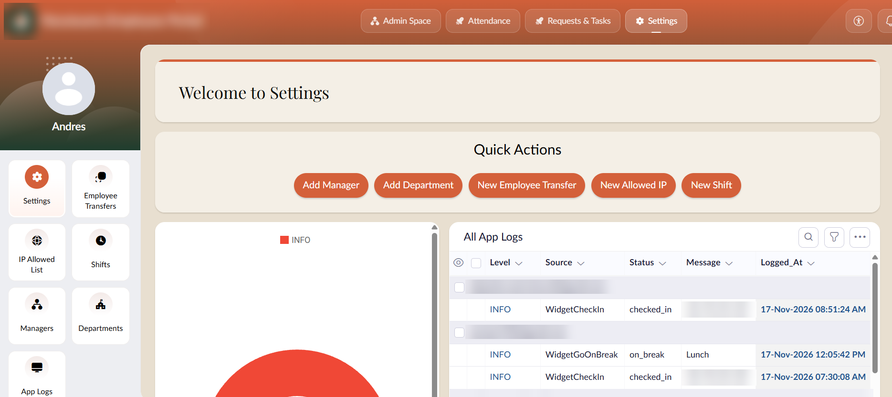
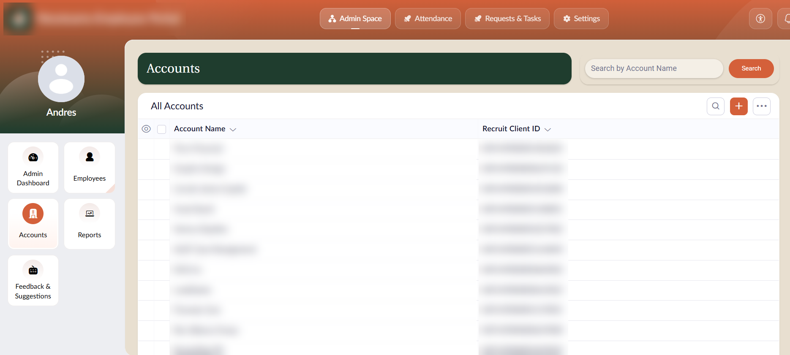
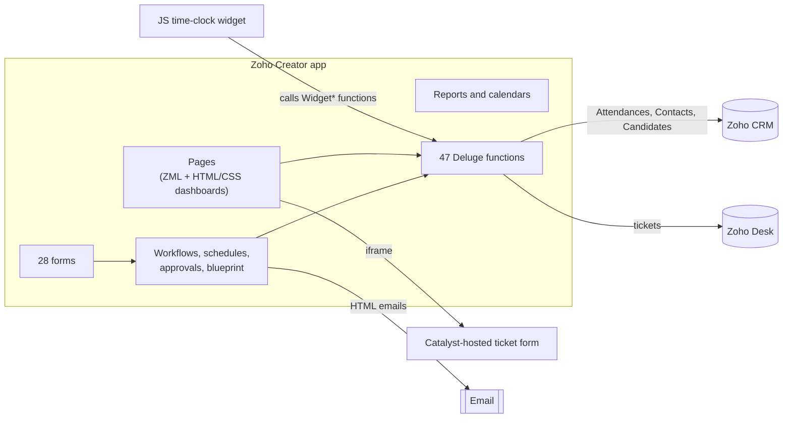

# Employee Portal for Zoho Creator: Case Study

A complete time, attendance and HR self-service portal built as a **Zoho Creator application**.

It is meant for organizations that, for whatever reason, **cannot use Zoho People or a dedicated timesheet product** but **do have access to Zoho Creator**. Common reasons:

- Zoho People (or a third-party timesheet SaaS) is not in the budget, but Creator already is, for example through Zoho One or an existing Creator plan.
- The workforce mixes payroll staff, contractors and staff placed with client accounts, and off-the-shelf tools do not model that well.
- Attendance rules, leave accrual or approval chains are specific to a country or a client contract and need custom logic.
- The data has to live next to other Creator apps and sync with Zoho CRM and Zoho Desk.

Everything here was built on the low-code platform: forms, reports, pages, Deluge scripts, schedules, approvals and a blueprint, plus custom HTML/CSS dashboards inside Creator pages.

> This repository is a case study. It shows what the app does, how it is designed, redacted screenshots, and a few representative code samples. See [Source code](#source-code) below.

---

## Screenshots

Taken from the live app. Branding, employee names, photos, emails, client accounts and IP addresses are blurred.

| Employee dashboard | Admin dashboard |
|---|---|
|  |  |

| Timesheets and breaks | Employees |
|---|---|
|  |  |

| Attendance | Settings and app logs |
|---|---|
|  |  |

| Accounts |
|---|
|  |

---

## What it does

### For employees
- **Clock in / clock out** from a dashboard widget, with live status (working, on break, checked out).
- **Breaks and lunch** tracking (15 min, 30 min, 1 hour lunch), with automatic break-out when a shift is closed.
- **On-site vs remote detection**: the check-in compares the user's IP against an allow-list of office IPs. Remote check-ins create a *Remote Attendance* request that a manager approves.
- **Late reasons**: arriving after the shift start prompts for a reason.
- **Overtime requests** linked to a specific timesheet.
- **Leave requests** (vacation/PTO, sick days) with automatic day counting that skips weekends and holidays, and live PTO / sick-day balances.
- **Help desk tickets** submitted from the portal straight into Zoho Desk.
- **Feedback and suggestions** form, announcements and a company calendar.
- **Personal dashboard**: hours this week, attendance score, days present/absent this month, days since hire, shift schedule.

### For managers and admins
- **Admin dashboard** with attendance status counts across the company.
- **Approval workflows** for leave, remote attendance and overtime, with templated approval and rejection emails.
- **Shift management**: define shifts once, assign them to employees, and scheduled hours are calculated automatically.
- **Employee transfers** between client accounts, shifts and managers, with an audit record.
- **Onboarding blueprint** that keeps a new employee record in a "to finish" state until hire date and shift data are complete.
- **Workday calendar** with holidays and company days off that sync to the calendar view.
- **Per-account and per-region reports**, so a client account can see only the staff placed with them, split by country.
- **Portal invitations**: one click to invite an employee as a Creator portal user.

### Automation
| Schedule | What it does |
|---|---|
| Daily Attendance Status Update | Runs after each employee's shift end and classifies the day: Present, Undertime, Absent, No Check-Out, On Leave. |
| Daily Leave Accrual | Accrues PTO and sick-day balances per day, idempotent per date. |
| Daily Employee No Timein Report | Emails admins a list of employees who never clocked in. |
| Weekly Attendance Report | Builds and emails an HTML summary table of each employee's week. |
| Workversary Reminder | Emails the HR team on each employee's work anniversary. |
| Stale shift expiry | Closes shifts left open past the scheduled end plus a grace period and marks them "No Check-Out". |

### Integrations
- **Zoho CRM**: every check-in, break and check-out is mirrored to a CRM `Attendances` module, linked to a Contact (management) or Candidate (staff) record.
- **Zoho Desk**: tickets created in the portal are pushed to Desk and their status read back.
- **Zoho Catalyst**: the "Submit a Ticket" page embeds a ticket form hosted on Catalyst, prefilled with the signed-in employee's name and email.
- **Custom JS widget API**: the `Widget*` Deluge functions back a JavaScript time-clock widget embedded in the dashboard.
- **IP geolocation** lookup for remote check-ins.

---

## Architecture at a glance



More detail on the data model and the main flows is in [docs/ARCHITECTURE.md](docs/ARCHITECTURE.md).

---

## Repository layout

```
.
├── samples/                          # Representative Deluge excerpts
│   ├── calendar/getDayClassification.dg
│   ├── PTO/applyLeaveUsage.dg
│   ├── tools/appLog.dg, logInfo.dg, logError.dg
│   ├── WidgetCheckIn.dg
│   ├── WidgetGoOnBreak.dg
│   └── WidgetExpireStaleShifts.dg
└── docs/
    ├── ARCHITECTURE.md               # Data model, flows, approvals, permissions
    └── screenshots/                  # Redacted screenshots of the live app
```

---

## Technical highlights

- **Deluge at scale**: about 1,800 lines of server-side Deluge across 47 functions, organized into namespaces (`PTO`, `calendar`, `shift`, `tickets`, `tools`).
- **A small JSON-style API inside Creator**: the `Widget*` functions (`WidgetGetState`, `WidgetCheckIn`, `WidgetGoOnBreak`, `WidgetResume`, `WidgetCheckOut`, `WidgetIpCheck`, `WidgetWhoAmI`) return maps with a crash-safe default status, so a custom JavaScript widget can drive the whole time clock.
- **Idempotent schedules**: the leave accrual job records the last processed date, so a re-run never double counts.
- **Business calendar logic**: `calendar.getDayClassification` decides if a date is a workday, weekend, holiday, company day off or approved leave for a specific employee, and every downstream job (accrual, absence, reports) reuses it.
- **Structured logging**: `tools.logInfo / logWarn / logError` write to an `App_Logs` form so failures in scheduled jobs are visible inside the app.
- **Custom UI inside Creator pages**: dashboards are hand-written HTML and CSS rendered through ZML, with design tokens as CSS variables, instead of the default page builder widgets.
- **Role-based access**: separate permission profiles for Administrator, Manager, Team Supervisor, Employee, Client and Read-only users.
- **Localized HR fields**: the employee record supports country-specific data such as civil status, nationality, residence type, dependents and local bank accounts.

---

## Source code

The complete app (28 forms, 47 functions, workflows, schedules, approvals and pages) is not published here. The files in [`samples/`](samples) are excerpts chosen to show how the code is written:

| Sample | What it shows |
|---|---|
| [`calendar/getDayClassification`](samples/calendar/getDayClassification.dg) | Business-calendar rules kept in one reusable function |
| [`PTO/applyLeaveUsage`](samples/PTO/applyLeaveUsage.dg) | Balance validation with clear result maps instead of exceptions |
| [`WidgetCheckIn`](samples/WidgetCheckIn.dg) | IP allow-list check, geolocation, on-site vs remote branching |
| [`WidgetGoOnBreak`](samples/WidgetGoOnBreak.dg) | Guarded state changes on a subform, server-synced timers |
| [`WidgetExpireStaleShifts`](samples/WidgetExpireStaleShifts.dg) | Scheduled cleanup with a grace period |
| [`tools/appLog`](samples/tools/appLog.dg) | Structured in-app logging that can never break the caller |

I'm happy to walk through the full app in an interview.

---

## About

Designed and built by Andrés Mendoza as a full-stack Zoho Creator project: data model, Deluge back end, UI, automation and integrations.
