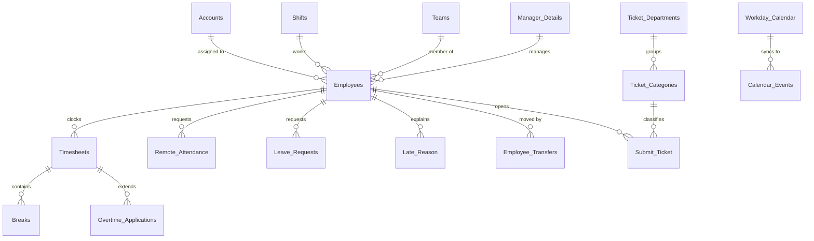
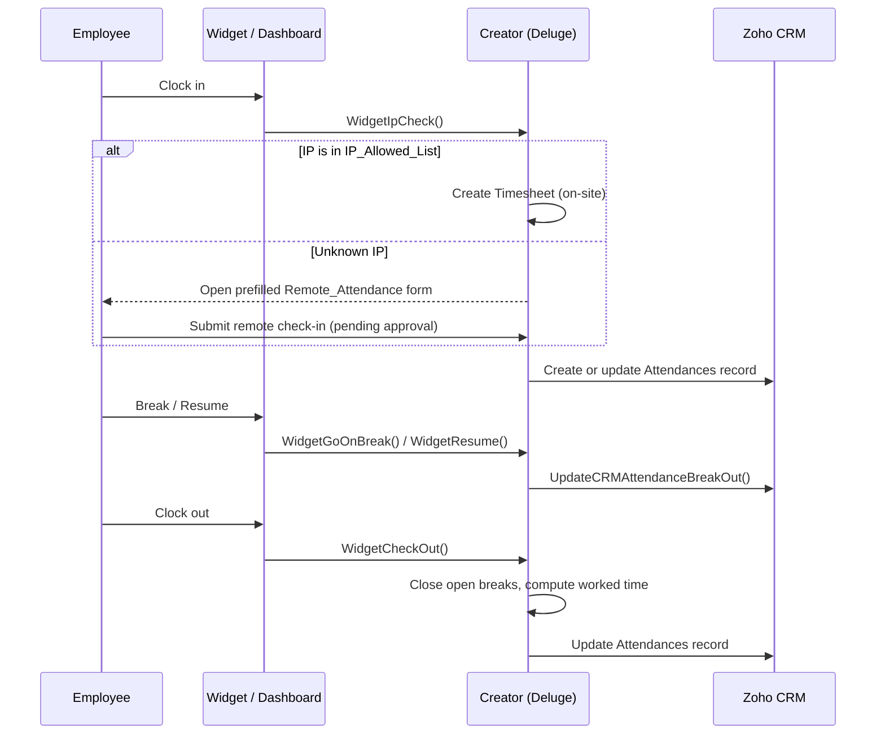

# Architecture

## Data model

Supporting forms: `IP_Allowed_List` (office IPs), `Announcements`, `Alert`, `Feedback_Suggestions`, `Portal_Invite`, `Attendance_Approval`, `App_Logs`, `Stateless_Timesheets` (filter UI), `work_timing`, `Clients`.

## Check-in flow

## Daily jobs

1. **Stale shift expiry** (`WidgetExpireStaleShifts`): any timesheet still open 2 hours past its scheduled end, or from a previous day, is closed as `No Check-Out` and its open breaks are ended.
2. **Attendance status** (`dailyAttendanceStatusUpdate`): runs per employee after their shift end. Uses `calendar.getDayClassification` to skip weekends, holidays, company days off and approved leave, then sets the day to Present, Undertime or Absent.
3. **Leave accrual** (`PTO.dailyLeaveAccrual`): adds the per-day PTO and sick-day rate for the employee's location. Guarded by `Last_Accrual_Date` so it runs at most once per day.

## Approvals

| Approval | Form | Result |
|---|---|---|
| Leave | `Leave_Requests` | Two-level approval. The balance is checked and reserved on submit by `PTO.applyLeaveUsage` |
| Remote attendance | `Remote_Attendance` | On approve, creates the timesheet and the CRM attendance record |
| Overtime | `Overtime_Applications` | On approve, writes overtime minutes back to the timesheet and CRM |

Each approval sends a templated HTML email to the employee on approve or reject.

## Onboarding blueprint

`Finish_Employee_Record` holds new employee records whose hire date or shift data is missing, and moves them forward once the record is complete, so incomplete employees never enter the daily jobs.

## Logging

All functions that can fail in a scheduled context call `tools.logInfo`, `tools.logWarn` or `tools.logError`. These write to `App_Logs` with level, source, status, message and record ID, which gives an in-app audit trail without external tooling.

## Permission profiles

| Profile | Access |
|---|---|
| Administrator | Everything |
| Manager | Team records, approvals, reports |
| Team Supervisor | Team attendance and approvals, limited admin |
| Employee | Own timesheets, leave, tickets, dashboard |
| Client | Read-only view of staff placed on their account |
| Read | Read-only across components |
